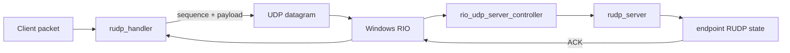

# YCNet RIO + RUDP

Windows Registered I/O(RIO) 기반 UDP 전송 계층과 신뢰성 보강 계층(RUDP)을 복구하고, 실패 재현 테스트를 먼저 추가하면서 개선한 포트폴리오 프로젝트입니다.

기존 공개 YCNet 저장소는 당시 구현을 남겨두기 위한 기록으로 유지하고, 이 저장소에서 검증 가능한 형태로 재구성했습니다.

## 구현 범위

- Windows RIO 기반 UDP 서버
- 엔드포인트별 RUDP 상태 관리
- 6-bit 시퀀스 / ACK / 재전송 처리
- ACK 유실 시 중복 패킷 재-ACK
- RTT 기반 적응형 RTO + timeout backoff
- 재전송 패킷 RTT 샘플 제외(Karn 방식)
- 64-slot reliable send window 포화 처리
- 시퀀스 wrap-around 순서 비교
- 런타임 RUDP 메트릭
- 다중 클라이언트 / 서버 수용량 / 패킷 손실 회귀 테스트
- YCNet을 실제 전송 계층으로 사용하는 authoritative 2D arena demo

## 구조



`rudp_handler`는 reliable packet의 시퀀스, ACK, resend timer와 RTO를 관리합니다. 서버는 RIO completion queue에서 수신한 UDP datagram을 엔드포인트별 RUDP 상태로 전달합니다.

## 개선한 문제

| 문제 | 기존 실패 형태 | 개선 | 검증 |
| --- | --- | --- | --- |
| ACK 유실 | 수신자는 이미 받은 패킷을 무시하고 ACK도 다시 보내지 않아 송신측이 계속 재전송 | duplicate reliable packet 재-ACK | `ack_loss_tests`, `rio_ack_loss_smoke` |
| 고정 재전송 시간 | 네트워크 RTT 변화 반영 불가 | SRTT/RTTVAR 기반 RTO, timeout 2x backoff | `rudp_tests`, `metrics_tests` |
| 송신 윈도우 포화 | 64개 slot 이후 기존 상태 덮어쓰기 가능 | reliable send 거부 + 로그 | `send_window_tests` |
| 시퀀스 wrap | 31/32, 63/0 경계 순서 오판 | modulo half-range 비교 | `rudp_tests` |
| 서버 수용량 초과 | 빈 client id queue에서 `back()` 호출 가능 | 신규 엔드포인트 명시적 거부 | `rio_capacity_smoke` |
| timeout 후 id 재사용 | 만료된 endpoint→id 매핑이 남아 새 클라이언트와 같은 id를 가리킬 수 있음 | timeout 시 endpoint 매핑 제거 후 id 반환 | `rio_timeout_reuse_smoke` |
| client unreliable send | 오래된 `ready_to_send` 호출 시그니처가 템플릿 인스턴스화 전까지 발견되지 않음 | resend buffer를 포함한 현재 API로 호출 정합성 복구 | `arena_network_smoke` |

## 검증

Visual Studio 2022 / Windows SDK 10.0.19041 / Debug 구성에서 다음 13개 테스트를 `CTest`로 실행합니다.

```powershell
cmake -S . -B build -G "Visual Studio 17 2022" -A x64
cmake --build build --config Debug --parallel
ctest --test-dir build -C Debug --output-on-failure
```

현재 회귀 테스트 결과: **13/13 통과**.

- RUDP ACK / sequence / reorder / wrap-around
- ACK 유실 재현
- reliable send window 포화
- 1% / 5% / 10% deterministic packet loss
- Windows RIO 단일 클라이언트
- Windows RIO 8-client isolation
- MaxClient 초과 거부
- timeout endpoint 정리 및 client id 재사용
- runtime metrics
- reproducible loss benchmark
- authoritative arena world simulation
- Windows RIO 2-client arena integration

## Authoritative Arena Demo

`examples/arena`에는 YCNet을 실제 전송 계층으로 사용하는 작은 2D arena 시나리오가 있습니다. 서버가 위치·HP·사망 상태를 결정하며, 두 bot client가 실제 loopback UDP/RIO 경로로 접속합니다.

패킷 정책은 역할에 따라 분리했습니다.

| 데이터 | 정책 | 이유 |
| --- | --- | --- |
| join | reliable | 연결 식별 이벤트 유실 방지 |
| movement input | unreliable | 다음 입력이 계속 도착하는 latency-sensitive 상태 |
| world snapshot | unreliable | 최신 상태가 과거 snapshot보다 중요 |
| attack | reliable | 단발성 게임 이벤트 유실 방지 |
| damage | reliable | HP 변경 이벤트 유실 방지 |

```powershell
.\build\Debug\arena_demo.exe
```

검증한 실행 시나리오:

1. bot 2개 RIO 접속 및 join nonce→server client id 매핑
2. 양쪽 bot이 중심으로 이동하며 서버가 입력을 정규화·경계 제한 후 authoritative simulation
3. 한 bot이 상대를 네 번 공격
4. 상대 HP가 `100 → 75 → 50 → 25 → 0`
5. 양쪽 client가 damage event를 각각 4회 수신
6. client별 reliable/unreliable send 수, retransmission, 현재 RTO 출력

`arena_network_smoke`는 같은 흐름을 자동 검증하며, client id의 UDP 도착 순서를 가정하지 않고 join nonce로 실제 server id를 확인합니다.

## RUDP 손실 벤치마크

아래 값은 deterministic datagram loss simulator에서 reliable message 100개를 전송한 실제 실행 결과입니다.

```powershell
.\build\Debug\loss_benchmark.exe 100
```

| 손실률 | 메시지 전달 | 시도 datagram | drop | 재전송 | 최종 RTO |
| ---: | ---: | ---: | ---: | ---: | ---: |
| 0% | 100 / 100 | 200 | 0 | 0 | 10 ms |
| 1% | 100 / 100 | 204 | 2 | 2 | 10 ms |
| 5% | 100 / 100 | 222 | 11 | 11 | 10 ms |
| 10% | 100 / 100 | 249 | 25 | 25 | 20 ms |

이 벤치마크는 인터넷 환경의 처리량 측정이 아니라 손실 조건에서 재전송과 reliable delivery 동작을 반복 재현하기 위한 검증 도구입니다.

## 런타임 메트릭

`rudp_handler::metrics()`에서 다음 상태를 확인할 수 있습니다.

- `reliable_sent`
- `unreliable_sent`
- `retransmissions`
- `acks_received`
- `duplicate_reacks`
- `rejected_reliable_sends`
- `current_rto_ms`

## 다음 확장

- 공개 GitHub remote 생성 후 코드 deep link 연결
- arena 실행 화면/GIF 또는 상태 시각화 추가
- packet loss / retransmission / RTO를 demo 화면에서 함께 표시
