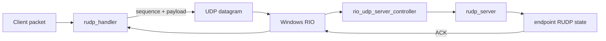
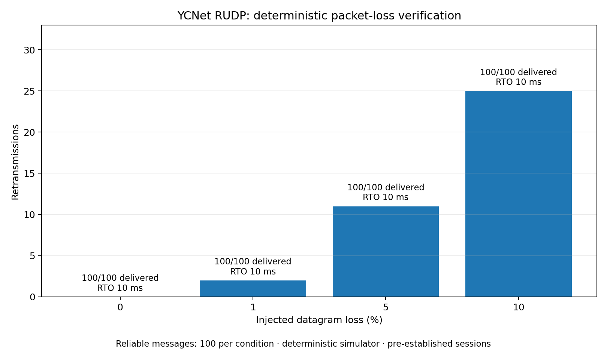

# YCNet RIO + RUDP

코어 API 이름은 snake_case와 역할별 `ycnet` 네임스페이스로 정리했습니다. [이름 규칙 및 변경표](docs/naming_conventions.md), [코어 포트폴리오 검토](docs/portfolio_core_review.md)를 참고하세요.

Windows Registered I/O(RIO) 기반 UDP 전송 계층과 신뢰성 보강 계층(RUDP)을 복구하고, 실패 재현 테스트를 먼저 추가하면서 개선한 포트폴리오 프로젝트입니다.

기존 공개 YCNet 저장소는 당시 구현을 남겨두기 위한 기록으로 유지하고, 이 저장소에서 검증 가능한 형태로 재구성했습니다.

## 구현 범위

- Windows RIO 기반 UDP 서버
- 엔드포인트별 RUDP 상태 관리
- 32-bit 패킷 식별 번호 / ACK / 재전송 처리
- ACK 유실 시 중복 패킷 재-ACK
- RTT 기반 적응형 RTO + timeout backoff
- 재전송 패킷 RTT 샘플 제외(Karn 방식)
- 64-slot reliable send window 포화 시 `try_send()` → `would_block`
- 패킷 번호와 64칸 링 버퍼 분리, 과거 데이터·ACK 재주입 거부
- HELLO/CHALLENGE/CONFIRM 연결 확인 및 양쪽 세션 ID 검사
- 송신 ACK 진행 / 수신 순서 진행 / 연결 확인 타임아웃 분리
- 종료 원인과 미확인 메시지 수를 전달하는 실패 콜백
- 런타임 RUDP 메트릭
- 다중 클라이언트 / 서버 수용량 / 패킷 손실 회귀 테스트

## 디렉터리

공개 헤더는 `include/ycnet`에 모으고, 애플리케이션에서는 `#include "ycnet/ycnet.hpp"`로 사용합니다. CMake 라이브러리 타깃과 네임스페이스는 `ycnet`입니다.

IDE에서 concepts/ranges 등에 잘못된 빨간 줄이 나타나면 [CMake/IDE 설정](docs/editor_setup.md)을 참고하세요. `tools/configure_editor.ps1`이 clangd용 CMake 컴파일 명령 DB를 생성합니다.

## 구조



`rudp_handler`는 reliable packet의 시퀀스, ACK, resend timer와 RTO를 관리합니다. 서버는 RIO completion queue에서 수신한 UDP datagram을 엔드포인트별 RUDP 상태로 전달합니다.

## 개선한 문제

| 문제 | 기존 실패 형태 | 개선 | 검증 |
| --- | --- | --- | --- |
| ACK 유실 | 수신자는 이미 받은 패킷을 무시하고 ACK도 다시 보내지 않아 송신측이 계속 재전송 | duplicate reliable packet 재-ACK | `ack_loss_tests`, `rio_ack_loss_smoke` |
| 고정 재전송 시간 | 네트워크 RTT 변화 반영 불가 | SRTT/RTTVAR 기반 RTO, timeout 2x backoff | `rudp_tests`, `metrics_tests` |
| 송신 윈도우 포화 | 기존에도 사용 중인 슬롯 재사용은 거부했으나 호출자는 실패 원인 구분이 어려움 | 64칸 유지, `try_send()`의 `would_block`으로 재시도 명시 | `send_window_tests`, `reliability_policy_tests` |
| 시퀀스 재사용 | 64개 처리 후 과거 데이터·ACK가 새 패킷으로 처리됨 | 32-bit 전체 번호와 64칸 슬롯 분리, ACK 전체 번호 검사, 상한 도달 시 재사용 거부 | `sequence_reuse_tests`, `rudp_tests` |
| RTO와 연결 실패 혼동 | RTO backoff가 1초를 넘으면 정상 손실 연결도 재전송 중단 | 패킷별 backoff 상한과 10초 진행 제한 분리 | `reliability_policy_tests`, 전체 KCP 비교 |
| 이전 연결의 패킷 재도착 | 같은 endpoint와 번호를 재사용하면 옛 데이터·ACK가 새 연결에 적용 가능 | 양쪽 세션 ID 및 연결 확인, 서버 슬롯 반환 후 옛 데이터로 연결 생성 금지 | `rio_timeout_reuse_smoke`, `reliability_policy_tests` |
| 서버 수용량 초과 | 빈 client id queue에서 `back()` 호출 가능 | 신규 엔드포인트 명시적 거부 | `rio_capacity_smoke` |
| timeout 후 id 재사용 | 만료된 endpoint→id 매핑이 남아 새 클라이언트와 같은 id를 가리킬 수 있음 | timeout 시 endpoint 매핑 제거 후 id 반환 | `rio_timeout_reuse_smoke` |

## 검증

Visual Studio 2022 / Windows SDK 10.0.19041에서 기본 코어 테스트 14개를 `CTest`로 실행합니다. KCP 비교 옵션을 켜면 무손실 및 손실 비교 smoke를 포함해 15개입니다.

```powershell
cmake -S . -B build -G "Visual Studio 17 2022" -A x64
cmake --build build --config Release --parallel
ctest --test-dir build -C Release --output-on-failure
```

현재 Release 회귀 테스트 결과: 비교 옵션 포함 **15/15 통과**. 전체 비교에서도 프로토콜별 144개 구성 모두 내용·순서 및 최종 ACK 확인을 완료했습니다. [정책 및 재실행 결과](docs/reliability_policy.md)를 참고하세요.

- RUDP ACK / 전체 시퀀스 / reorder / 슬롯 재사용 / 과거 패킷 재주입
- ACK 유실 재현
- reliable send window 포화
- 1% / 5% / 10% deterministic packet loss
- Windows RIO 단일 클라이언트
- Windows RIO 8-client isolation
- max_clients 초과 거부
- timeout endpoint 정리 및 client id 재사용
- runtime metrics
- reproducible loss benchmark
- unreliable send 및 이전 상태 유실 후 다음 상태 전달

## RUDP 손실 벤치마크

아래 값은 deterministic datagram loss simulator에서 reliable message 100개를 전송한 실제 실행 결과입니다.



```powershell
.\build\Release\loss_benchmark.exe 100
python tools\render_loss_benchmark_chart.py --messages 100
```

원본 CSV는 `docs/loss_benchmark.csv`에 저장되며, 그래프도 같은 실행에서 다시 생성됩니다.

| 손실률 | 메시지 전달 | 시도 datagram | drop | 재전송 | 최종 RTO |
| ---: | ---: | ---: | ---: | ---: | ---: |
| 0% | 100 / 100 | 200 | 0 | 0 | 10 ms |
| 1% | 100 / 100 | 204 | 2 | 2 | 10 ms |
| 5% | 100 / 100 | 222 | 11 | 11 | 10 ms |
| 10% | 100 / 100 | 249 | 25 | 25 | 10 ms |

이 벤치마크는 인터넷 환경의 처리량 측정이 아니라 손실 조건에서 재전송과 reliable delivery 동작을 반복 재현하기 위한 검증 도구입니다.

## 런타임 메트릭

`rudp_handler::metrics()`에서 다음 상태를 확인할 수 있습니다.

- `reliable_sent`
- `unreliable_sent`
- `retransmissions`
- `acks_received`
- `duplicate_reacks`
- `rejected_reliable_sends`
- `current_rto_ms`
- `connection_timed_out`
- `pending_reliable`
- `rejected_session_packets`

## 다음 확장

Godot 게임 연동 및 KCP·ENet / RIO·IOCP 비교 방향은 [포트폴리오 프로젝트 제안](docs/project_direction.md)에 정리했습니다.

KCP와 가상 시계 기반 비교를 실행했고, YCNet의 timeout 및 과거 메시지 재전달 실패가 드러났습니다. [첫 비교 결과](docs/protocol_comparison.md)는 수정 전 기록으로 보존했습니다. 이후 [시퀀스 식별 수정](docs/sequence_identity_fix.md)으로 내용/순서 검증 실패가 12건에서 0건이 됐습니다. 이어 [신뢰성 정책 수정](docs/reliability_policy.md) 후에는 YCNet 144/144 구성이 최종 ACK까지 완료됐고 timeout도 0건이 됐습니다. 이 결과는 RIO 또는 실제 NIC 처리량 측정이 아닙니다.
