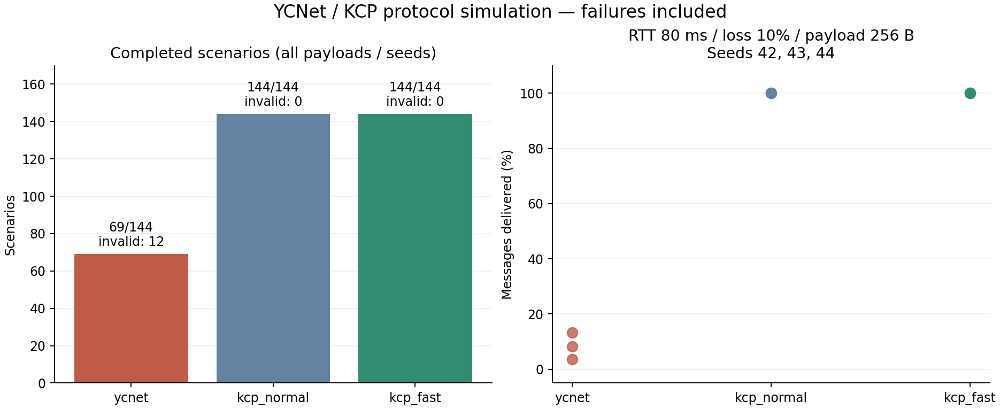

# YCNet / KCP 첫 비교 결과

이 문서는 6-bit 시퀀스를 사용하던 수정 전 결과다. 이후 번호와 슬롯을 분리한 변경 및 재실행 결과는 [시퀀스 식별 수정](sequence_identity_fix.md)에 기록했다.

2026-10-15 Windows / MSVC 19.41 / Release에서 실행했다. RIO나 실제 소켓을 쓰지 않는 단일 스레드 가상 시계 실험이다. 원본은 [CSV](protocol_comparison.csv), 이상 전달 기록은 [diagnostics](protocol_comparison_diagnostics.txt)다.



## 결과

프로토콜별로 payload 64/256/512 B × RTT 0/30/80/150 ms × 손실 0/1/5/10% × seed 42/43/44의 **144개 구성**을 실행했다. 각 구성은 300개 메시지를 초당 100개씩 제공한다. 이것은 동일 조건의 144회 독립 통계 반복을 의미하지 않는다.

| 구현 | CSV의 메시지 전달 완료 판정 | 내용/순서 검증 실패 | 완료되지 않았지만 내용 검증 실패는 없었던 구성 |
| --- | ---: | ---: | ---: |
| YCNet | 69 / 144 | 12 / 144 | 63 / 144 |
| KCP normal (10ms update) | 144 / 144 | 0 / 144 | 0 / 144 |
| KCP fast | 144 / 144 | 0 / 144 | 0 / 144 |

추가 감사: 현재 CSV의 `complete`는 `valid && accepted == offered && delivered == offered`만 검사한다. 실행 루프는 최종 ACK도 기다리지만, 제한 시간 도달 시 CSV 판정에는 ACK 잔량이 반영되지 않는다. 따라서 위 숫자를 엄밀한 최종 ACK 완료 수로 표현하면 안 된다. KCP receive window도 32를 요청했으나 고정한 버전의 `ikcp_wndsize`가 최소 128로 올린다. 아래 설정 설명을 이에 맞게 바로잡았다. 전체 성능 우열의 확정 근거로 사용하기 전에 계측을 보완해야 한다.

YCNet의 미완료 63개 구성에서는 `connection_timed_out` 상태를 확인했다. 현재 클라이언트 handler는 RTO backoff가 1000ms 제한을 넘으면 재전송 후보 반환이 중단되지만, 호출자가 알 수 있는 종료 콜백이나 새 연결 처리는 없다. 따라서 비교 harness가 메시지를 더 기다려도 전달이 끝나지 않는다. 이번 변경에서는 timeout 상태를 메트릭으로 노출했고 프로토콜 정책은 아직 수정하지 않았다.

검증 실패 12개는 이전 메시지가 다시 전달되는 사례다. 예를 들어 RTT 80ms·손실 1%·seed 42에서는 다음 메시지 index 276을 기대하는데 index 212가 들어왔다. index 차이는 시퀀스 공간과 같은 64다. 이후 별도 직접 재현에서 64개 메시지 처리 뒤 과거 첫 데이터가 새 데이터로 전달되고, 과거 첫 ACK가 아직 전달하지 않은 새 메시지를 확인 처리하는 것을 확인했다. 이 결함은 비교 harness와 독립적으로 존재한다. 각 벤치마크 실패의 세부 패킷 타임라인까지 모두 원인을 확정한 것은 아니며 아직 수정하지 않았다.

RTT 80ms·손실 10%·256 B에서 YCNet은 seed별로 300개 중 40/11/25개만 전달했고 두 KCP 모드는 모두 300개를 전달했다. 미완료 실행의 p95는 전달된 일부 메시지만의 지연이므로 KCP의 전체 완료 지연보다 낮다는 이유로 YCNet이 빠르다고 해석하면 안 된다.

## 설정과 측정 범위

- KCP 소스 commit: `b1a7a2101dcbb96017681a500d6b82bbe5a88766`. 공식 소스와 라이선스를 `.dependencies/kcp`에 별도 checkout하며 저장소에 포함하지 않는다. 이 환경에서는 `ikcp.c`를 C++로 컴파일했다.
- 같은 메시지 body, 한 방향 reliable ordered 전달, 양방향 ACK, application admission의 in-flight 상한 16, 호출 주기 10ms, MTU 상한 1024 B를 적용했다. KCP receive window는 32를 요청하지만 실제 값은 최소 제한 때문에 128이다. YCNet의 admission 제한은 미확인 개수 기준이며 oldest-unacked 기준의 sequence span 제한을 보장하지 않는다.
- YCNet은 기존 RTO 및 timeout 정책을 유지한다. KCP normal은 `ikcp_nodelay(0, 10, 0, 0)`, fast는 `(1, 10, 2, 1)`이다. normal도 호출 interval을 맞춘 설정이며 전체 기본 설정을 그대로 사용한 결과는 아니다.
- 각 datagram에 PRNG 기반 독립 손실을 적용한다. 같은 seed라도 프로토콜의 packet 구성 및 ACK 수가 달라 같은 메시지가 유실되지는 않는다.
- 네트워크는 고정 one-way 지연 RTT/2를 사용한다. jitter·burst loss·reorder·대역폭 제한·혼잡은 모델링하지 않았다. 무손실 RTT 0은 즉시 송신하는 YCNet에 유리한 합성 조건이며 실제 NIC 지연을 뜻하지 않는다.
- `udp_payload_bytes`는 ACK와 유실 시도까지 포함한 UDP payload bytes다. IP/UDP/Ethernet 헤더는 포함하지 않는다.
- end-to-end 지연은 애플리케이션의 원래 제공 시각부터, transport 지연은 프로토콜에 실제 수용된 시각부터 잰다. 수용을 기다리는 application backlog를 따로 기록한다.
- 실행 루프의 정상 조기 종료 조건은 메시지 body·순서가 맞고, 모든 메시지가 전달되며, 송신측의 확인도 끝난 경우다. CSV의 `complete` 판정에는 최종 ACK 확인이 빠져 있다. 제한 시간은 메시지 제공 기간에 30초를 더한 값이다.
- CPU·실제 처리량·NIC·다중 클라이언트·혼잡 제어 우열을 이 결과로 주장하지 않는다.

## 재현

```powershell
pwsh -File tools/run_protocol_comparison.ps1
python tools/render_protocol_comparison.py
```

스크립트는 고정 KCP checkout → Release 빌드 → 회귀 테스트 → 전체 비교 → CSV 저장 순서로 실행한다. 미완료/오류 구성도 CSV에 보존하고 경고한다. 빌드 경로는 `build/Release`로 유지한다.

기본 코어 테스트는 12개다. 비교 옵션을 켜면 무손실 프로토콜 smoke 1개가 추가되어 현재 CTest **13/13 통과**다. 전체 손실 매트릭스의 실패는 이 무손실 smoke 결과와 별개이고 위 표에 그대로 기록했다.

## 다음 작업

1. 위 두 실패 조건의 작은 패킷 타임라인 재현 테스트.
2. 시퀀스 재사용·지연 패킷 구분 및 클라이언트 timeout 정책 정리.
3. 수정 전후 동일 CSV 비교. 실패가 사라진 뒤 지연과 packet 비용을 비교.
4. 안전성·wire protocol 보완 후 Godot 협동 운송 게임 연동.
