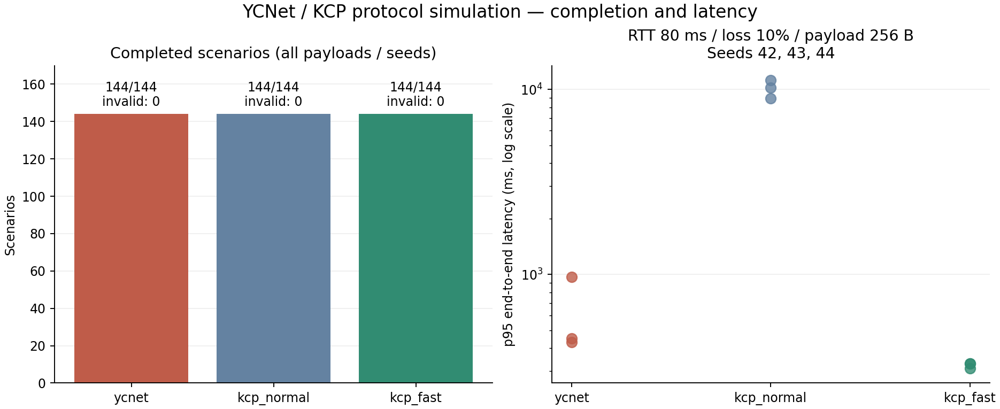

# RUDP 신뢰성 정책과 벤치마크 재실행

2026-10-15, Windows / MSVC 19.41 / Release. 기존 64칸 고정 버퍼를 유지하고 패킷 식별, 연결 식별, 전송 거부, 전달 실패를 구분했다. 서버와 클라이언트는 같은 `rudp_handler`로 프로토콜을 처리한다.

## 전송 계약

- `try_send()` → `accepted`: 전송 계층이 메시지를 보관했다. 상대의 수신이나 게임 로직 처리가 완료됐다는 뜻은 아니다.
- `would_block`: 64칸 또는 가장 오래된 미확인 번호 기준의 윈도우가 막혔다. 메시지를 수용하지 않았으므로 호출자가 보관하고 재시도한다. 기존 메시지는 덮어쓰지 않는다.
- `packet_too_large`: 전송 크기 제한 위반. 수용하지 않는다.
- `closed`: 종료된 연결에는 새 전송을 받지 않는다.
- `sequence_exhausted`: 32-bit 식별번호를 소진하면 실패를 알리고 연결을 종료한다. 같은 연결에서 0번으로 돌아가지 않는다.

기존 reliable `send()`의 bool 반환은 호환용으로 유지했다. 새 코드는 `try_send()`로 실패 원인을 구분한다. 내부에 무제한 대기 큐를 추가하지 않았다. 연결 확인 중인 reliable 메시지도 같은 64칸에 보관한다. unreliable 메시지는 연결 확인 전 `would_block`을 반환하며 호출자가 재시도해야 한다.

## 식별과 연결 확인

버퍼 슬롯은 `sequence % 64`다. 패킷 식별번호는 32-bit이며 두 값은 독립적이다. 데이터와 ACK의 헤더는 **21 B**다.

| 바이트 | 내용 |
| --- | --- |
| 0 | version 2 / reliable / ACK / control flags |
| 1–4 | big-endian uint32 sequence. 제어 메시지에서는 종류 |
| 5–12 | big-endian uint64 송신 측 세션 ID |
| 13–20 | big-endian uint64 수신 측 세션 ID |

`HELLO → CHALLENGE → CONFIRM`으로 양쪽 ID를 확인한다. HELLO는 destination=0이며, 서버는 새 ID로 challenge를 보낸다. 연결마다 양쪽 ID가 새로 생성된다. 정상 데이터·ACK는 양쪽 ID가 모두 일치해야 처리한다. CONFIRM이 유실된 경우 올바른 ID의 데이터도 연결 확인으로 인정한다. 제어 메시지도 재전송한다.

서버는 모르는 endpoint의 데이터·ACK·CONFIRM만으로 연결을 만들지 않는다. 지연된 옛 HELLO가 도착하면 제한된 연결 확인 슬롯을 사용할 수 있지만, 새 서버 ID에 대한 확인 없이 앱 연결 콜백이나 데이터 전달은 발생하지 않는다. 확인 대기는 최대 클라이언트 수 안에서 제한하고 만료 시 반환한다. 현재 활성 연결과 다른 클라이언트 ID의 HELLO는 기존 연결을 교체하지 않는다.

세션 ID는 프로세스 내 증가값이며 시작값은 무작위다. 프로세스 재시작 간 충돌 가능성은 유한한 무작위 ID의 한계를 가진다. 인증·암호화 프로토콜은 아니다. 동일 endpoint의 즉시 재접속은 기존 연결을 `disconnect()`하거나 timeout으로 정리한 뒤 새 handler로 시작한다.

기존 1 B / 5 B 프로토콜과 호환되지 않으므로 양쪽을 같이 빌드해야 한다. 전체 UDP payload 상한 1024 B, 앱 size/id 헤더 3 B이므로 앱 body 상한은 **1000 B**다. 앱 데이터 직렬화는 아직 기존 C++ 구조체 기반이며 Godot용 wire schema는 별도 작업이다.

## 타이머와 실패

기본값은 다음과 같다. `set_reliability_options()`로 변경한다.

| 항목 | 기본값 | 동작 |
| --- | ---: | --- |
| 최초 RTO | 100 ms | RTT 샘플 이후 SRTT/RTTVAR로 갱신 |
| 재전송 간격 상한 | 1000 ms | 패킷별 2배 backoff를 여기서 제한. 연결 종료 조건이 아님 |
| 송수신 진행 제한 | 10000 ms | 미확인 송신이 있는데 유효 ACK가 없거나, 수신 순서 공백이 해소되지 않으면 종료 |
| 연결 확인 제한 | 10000 ms | 연결 확인이 끝나지 않으면 종료 |
| 연결 확인 재시도 | 100 ms | HELLO / CHALLENGE 재전송 |

송신 ACK 진행과 수신 순서 진행의 타이머는 독립적이다. 반대 방향 데이터 수신이나 중복 ACK는 송신 정체를 연장하지 않는다. RTT가 안정됐을 때도 계산에 최소 1 ms 타이머 해상도를 남겨, ACK 도착 시각과 RTO가 같아지는 경계에서의 불필요한 재전송을 줄였다. 재전송한 패킷의 ACK는 RTT 샘플에서 제외한다.

실패 시 상태를 `closed`로 바꾸고, 버퍼를 정리하며, `set_failure_callback()`으로 종료 원인과 `unconfirmed_messages`를 한 번 전달한다. 미확인 메시지는 **전달 여부 불명**이다. 상대가 받았어도 ACK만 유실됐을 수 있으므로 재접속 후 무조건 재전송하면 앱 작업이 중복될 수 있다. 업무 단위의 중복 방지는 앱 메시지 ID가 담당해야 한다.

미확인 송신도 수신 공백도 없는 유휴 연결은 자동 종료하지 않는다. 현재 heartbeat/idle timeout은 없으므로 앱이 `disconnect()`로 정리한다. 클라이언트별 메모리와 서버 수용량은 제한되어 있다. 연결 종료를 원격에 통보하는 별도 CLOSE 메시지는 아직 없다.

서버의 `process_received_packets()`는 활성 연결과 연결 확인 대기의 타이머도 진행시킨다. 클라이언트는 `process_retransmissions()`를 주기적으로 호출해야 한다. 프로토콜 API는 한 소유 스레드에서 호출한다. 콜백에서 send/close는 가능하지만 handler를 파괴하거나 receive/poll을 재진입하면 안 된다.

## 검증

Release CTest **15/15 통과**. 새 정책 회귀는 다음을 검사한다.

- 65번째 전송의 `would_block`, ACK 이후 재시도 성공, 기존 미확인 데이터 유지.
- RTO 상한 도달 후에도 재전송 지속, 정확한 진행 제한에서 실패 한 번 통지.
- ACK 전부 유실 시 수신자는 한 번 전달하고 송신자는 전달 여부 불명으로 종료.
- 반대 방향의 정상 수신으로 송신 ACK 정지가 가려지지 않음.
- 수신 순서 공백의 제한 시간, 연결 확인 중 64개 보관 상한.
- HELLO / CHALLENGE / CONFIRM 각각 첫 유실 후 복구.
- 연결 확인 실패와 종료 후 늦은 ACK / 새 전송 거부.
- 실제 RIO 서버에서 timeout 슬롯 반환, 옛 데이터만으로 재접속 금지.
- **같은 소켓·주소로 재접속**한 뒤 옛 데이터와 ACK를 재주입해도 새 0번이 영향받지 않음.

기존 4096개 메시지 순서·내용, 역순 64개, 슬롯 재사용, 전체 번호 경계 테스트도 유지했다. 비교 CTest에는 RTT 150 ms / 손실 10% 조건을 추가했다.

## 비교 결과

원본 [CSV](protocol_comparison_policy.csv), [실행 설정 및 diagnostics](protocol_comparison_policy_diagnostics.txt).

payload 64/256/512 B × RTT 0/30/80/150 ms × 독립 datagram 손실 0/1/5/10% × seed 42/43/44 = 프로토콜별 **144개 구성**, 구성당 300개 메시지. 제공률 100 messages/s, admission 최대 16개, update 10 ms. 고정 KCP commit과 모드는 [첫 실험](protocol_comparison.md)과 같다.

이번 `complete`는 내용·순서 검증, 전 메시지 수용·전달, **최종 미확인 메시지 0개**, 실행 제한 시간 준수, YCNet 연결 실패 없음까지 검사한다. 이전 CSV의 complete는 마지막 ACK 조건이 빠져 있으므로 과거 수치는 메시지 전달 완료 기록으로만 해석한다.

| 구현 | 전달 및 최종 ACK 완료 | 내용·순서 오류 | YCNet 연결 timeout |
| --- | ---: | ---: | ---: |
| YCNet | 144/144 | 0 | 0 |
| KCP normal | 144/144 | 0 | 해당 없음 |
| KCP fast | 144/144 | 0 | 해당 없음 |

시퀀스만 고친 직전 실행에서는 YCNet 메시지 전달 완료 78/144, 오류 0, timeout 66건이었다. 이번에는 그 66개 구성도 최종 ACK까지 완료했다. 각 구성은 서로 다른 조건이므로 동일 조건 144회 반복 통계는 아니다.



RTT 80 ms / 손실 10% / body 256 B의 예시는 다음과 같다. p95는 앱의 원래 제공 시각부터 잰 지연이고, bytes는 ACK·유실 시도 포함 UDP payload다.

| 구현 | seed 42/43/44의 p95 (ms) | seed 42/43/44의 UDP bytes |
| --- | --- | --- |
| YCNet | 430 / 450 / 970 | 158298 / 160559 / 156177 |
| KCP normal | 11250 / 10250 / 8940 | 111792 / 109280 / 107384 |
| KCP fast | 310 / 330 / 330 | 119872 / 119744 / 100000 |

이 조건에서는 **KCP fast가 YCNet보다 지연과 전송 bytes 모두 낫다.** KCP normal은 혼잡 제어를 유지하고 fast는 비활성화하므로 모드 차이를 일반적인 성능 우열로 해석하지 않는다. 무손실 RTT 80 ms / body 256 B에서는 YCNet과 fast 모두 p95 40 ms, UDP bytes는 각각 90300 / 91200이었다.

비교는 미리 연결된 세션의 ARQ만 측정한다. YCNet 연결 확인은 별도 회귀에서 검증했으며 비교 CSV의 비용에는 포함하지 않는다. 가상 시계, 단일 스레드, 고정 지연이고 jitter/burst loss/대역폭 제한/혼잡/실제 RIO/NIC/CPU 처리량은 측정하지 않았다. YCNet 진행 제한 10초와 KCP의 실패 정책도 동일하게 맞춘 것은 아니다. 이 결과는 해당 매트릭스의 신뢰성 회귀 통과이며, 임의의 실제 네트워크에서의 무조건 전달이나 성능 우위를 증명하지 않는다.

## 재현

```powershell
pwsh -File tools/run_protocol_comparison.ps1
python tools/render_protocol_comparison.py
```

기본 출력은 `protocol_comparison_policy.csv`와 동일 이름의 diagnostics / PNG다. 이전 `protocol_comparison.csv`, `protocol_comparison_sequence32.csv`는 변경하지 않았다. 실행 경로는 기존 `build/Release`를 사용한다.
